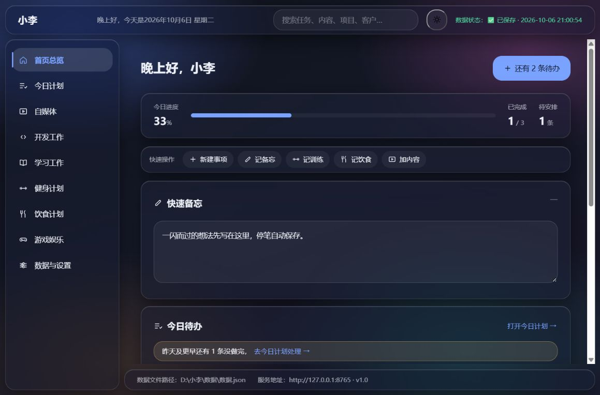

# 小李

> A local offline personal efficiency dashboard with macOS Liquid Glass UI.
> Run locally, store all data in JSON files, no database, no network requests.
> Contains schedule, media, development, fitness and diet modules.

只在你自己电脑上跑的个人工作台：**不登录、不联网、不上云、不装依赖**。
双击一个文件，浏览器打开十一个模块，所有数据存成本机一个 JSON 文件。

## 它长这样




## 十一个模块

| 模块 | 干什么 |
| --- | --- |
| 首页总览 | 简洁 / 完整双视图（默认简洁）：首屏今日进度 + 今日待办 + 财务摘要（含到期债务预警），高频模块摘要卡默认展示、次要模块折叠收起；另有两张现算不存数据的卡 —— **「各模块今日进度」**（健身/学习/饮食/开发工作/游戏娱乐各一行，`− 2/5 项 +` 快记，可超额；点整行跳今日计划对应分组）和只读的**「目标总览」**（每条模块目标一行，点一下跳回模块），完整模式直接摆出来、简洁模式收进「其他模块」折叠里展开才渲染；完整模式一次看全部模块 |
| 今日计划 | 上半张**「逾期待办」**、下半张**「今天的任务」**分成两张液态玻璃卡片，各自 `max-height` **内部独立滚动**（标题栏固定、条目少自动收缩、滚动条是全站那 6px 玻璃胶囊），互不带动；逾期卡空时显示「暂无逾期任务 🎉」，今日卡空时提示去添加。今天的任务（**点「添加任务」弹窗里填**，可标优先级、带图片备注）**按模块分组**（健身/学习/饮食/开发工作/游戏娱乐，每组带进度条和 `− 值/目标 单位 +` 快按钮，点模块名可**折叠/展开**这一组），不属于模块的自己排一列；进度支持**数量 / 时长两种类型**、**可超额完成**（配了目标值就按目标算，超额进度条满格绿色 + 「超额」标记）；模块的今日目标（类型 / 目标值 / 单位 / 步长）在弹窗里改，存在 `settings.dailyTargets`；顶部实时统计「未完成 / 已完成 / 完成百分比」+ 全局进度条，每行带优先级胶囊和**来源标签**；别的模块（开发工作的项目待办）勾上「加入今日计划」就会出现在这里和首页，**打勾只改那一条原始记录**，两边同时变；「昨天没做完的」一键挪到今天；**月历视图**看哪天有安排 |
| 自媒体 | 多平台账号（粉丝 / 本周涨粉 / 播放 / 待发布）+ 数据概览（汇总、近 30 天趋势、爆款 TOP3）+ 发布排期月历（平台筛选、拖拽排期）+ 想法 → 撰写中 → 剪辑中 → 待发布 → 已发布的流水，发布后录播放 / 点赞 / 单作品涨粉；另外挂着一个**全站共用的素材库**（图片 / 链接 / 文本片段三种，各模块的弹窗里都能勾，记录只存素材 id） |
| 开发工作 | 项目（**弹窗录入**，含详细描述 / 起止日期 / 截图；卡片**可拖拽排序**、可按关键词/状态**筛选**）+ 每个项目的待办（**弹窗录入**，可标优先级、带截图，尾部有个**「今日计划」勾选框**：勾上就同时出现在今日计划和首页，取消就只留在项目里；**删除仍然只能在项目里删**）/ 问题（**详细描述、关联模块、五档状态、可附截图**，可按状态/优先级/模块筛选，点条目展开看详情）/ 进展时间线（**可附截图、可编辑**）；两张卡片头部统一成一行「标题 · 统计 · 筛选 · 查看归档 · 添加」，条目操作是**鼠标移上去才露出来的小图标**；做完的待办、修好的问题可**归档**，归档的收进**右侧「归档记录」抽屉**（待办 / bug 两个标签，可搜索、按优先级和归档日期筛、单条或批量恢复，数据一个字节都不删；主列表、统计和搜索默认都不算归档） |
| 学习工作 | **模块目标**（周期 / 起止 / 自动任务规则，进度按天算）+ 学习对象（书/课程/视频/技能）+ 按天的学习记录（**都改成弹窗录入**，可带图片备注），记时长和心得，标「待复习/已复习」 |
| 记账 | 记一笔支出/收入（**可附多张图片备注**，小票截图、付款截图），月历上看每天花了多少（超支的日子标红），本月概览与总/分类预算，分类占比环形图，账户与余额；另有「债务欠款」子页（记录还款会自动生成一笔账目） |
| 健身计划 | **模块目标**（周期 / 起止 / 自动任务规则，进度按次算）+ 每周训练安排、按天打卡（**弹窗录入**，可带训练截图）、体重记录（自动算和上次的差） |
| 饮食计划 | **模块目标**（周期 / 起止 / 自动任务规则，进度按天算）+ 三餐和加餐、喝水杯数，能翻回前几天补记 |
| 游戏娱乐 | **游玩记录**（玩一次记一条：哪款游戏、哪天、多久、什么感受，**弹窗录入**、可带截图；默认看当天，能翻日期、按游戏名和日期范围筛历史，可一键计时）+ **游玩统计**（今日 / 本周 / 本月 / 全年总时长 + 玩得最多的 TOP3，本月超了「每月目标」还会提醒一句）+ 游戏清单：在玩 / 想玩 / 已通关 / 弃坑，记平台、每月目标、通关日期、进度，**累计时长由游玩记录自动算**（不用再手填），清单可拖拽排序、拖到别的分组就是换状态 |
| 笔记 | 左边列表、右边写；正文就是 **Markdown 源码**（标题 / 粗斜 / 行内代码与代码块 / 列表 / 引用 / 分割线 / 链接与图片），右上角「预览」并排看渲染结果；打字自动存、离开输入框刷新列表；能贴标签、贴图（附件目录 `note`），全文进全局搜索、点结果直达那一条 |
| 数据与设置 | 导出、导入恢复、自动备份、**回收站**、**图片附件**（占用与位置、压缩档位、彻底删除时是否连图片一起删）、**归档开关**（待办勾完成 / bug 标已修复时要不要自动归档）、外观与标语、清空数据 |

另外还有：顶部全局搜索、四套皮肤（液态玻璃 / 极简 / 笔记 / 粗野）× 明暗三态
（浅色 / 深色 / 跟随系统，跟着电脑自动变）、
软删除回收站、多窗口防覆盖、运行日志、一键自检。

## 怎么跑

需要电脑上有 **Python 3**（3.8 以上都行）。

**Windows**：双击 `启动.cmd`。黑窗口起来后浏览器会自动打开界面，
**关掉黑窗口就等于停止程序**。

**macOS / Linux**：在项目目录执行

```bash
python3 app/服务.py
```

它会起一个只监听 `127.0.0.1` 的小服务，然后手动打开它打印出来的地址。

## 看效果 / 演示

开发用的这一份可以一键塞一套样例数据（任务、学习记录、训练、体重、
自媒体……全都铺在当前这个月），用来演示、截图、看界面效果：

这套数据是**跟着功能一起更新的**（2026-10-08 补过一轮），各模块都铺满了，
每一版新加的东西都能在里面看见：模块目标与自动生成的待办、游戏游玩记录与统计、
自媒体的账号 / 粉丝快照 / 爆款榜 / 废弃归档、开发工作的待办与 bug 五个状态、
待办和 bug 的归档抽屉、记账的分类预算与超支红边、债务、回收站，
以及**待办跨模块联动**——今日计划里同时有「今日计划自己的」「开发工作加进来的」
「游戏娱乐顺手加的」「模块目标自动生成的」四种来源标签，行上有高 / 中 / 低
优先级胶囊，首页和今日计划的进度、数字都是同一份数据算出来的。

双击 `演示数据.cmd`，按数字选：**1** 载入示例数据（你现在这份会先存一份
快照，随时能还原）、**2** 还原回载入之前、**3** 只看现在有哪些数据、
**4** 载入到「现在正开着的那个小李」。

它默认只动**这份代码自己的** `数据\` 目录，不会碰你日常在用的那一份。
`同步到小李.cmd` 也不会把它（`演示数据.cmd` 和 `tools\`）带到日常那份去——
那套工具只服务开发版，免得哪天在日常那份里手一滑，把真实数据换成演示数据。
载入前的数据会存成 `备份\保留-演示前-*.json`（标着「长期保留」，自动清理
会跳过它），在「数据与设置 → 导入恢复」里也能选它还原。

另外：仓库和日常那份可以同时开着。启动时会先看端口上那个是不是「自己
这一份」，不是就往后找一个空端口（8766、8767……），绝不会把浏览器指到
另一份的旧界面上——这样你在开发版里改的东西一定能看见。

## 数据在哪

一份数据 = **一个文件夹**，里面就一个数据文件：`数据/默认/数据.json`（第一次运行时自动创建）。

```
数据/                    ← 数据根目录（多套数据就并排放在这儿）
  当前数据集.txt         现在用哪一份（就一行字，坏了也能自己改）
  默认/                  ← 一个数据集 = 一个文件夹，整份能搬走
    数据.json           全部数据就这一个文件，随时可以复制走
    attachments/        图片备注，按模块分成 finance/（记账）、buglog/（bug 截图）、
                        progress/（项目进展）、today_plan/、dev_project/、dev_todo/、
                        study_record/、study_item/、fitness/、game/、game_record/ 几个子文件夹
    备份/               每天首次打开自动存一份，保留最近若干份
      _最近一次.json     每次保存前的上一版
    导出/               手动导出的备份文件、打包好的数据集 zip
    日志/运行.log       启动、备份、导入这些关键事件的流水
  工作/                 另一套数据（在设置页点「用这份」就切过去）
```

**多套数据**：设置页最上面那张「数据集」卡片能新建、切换、重命名、导出（打包成 zip，
连着图片一起走）。同一时间只用一份，切换之后页面会重载；状态栏一直写着你在用哪一份。
老版本（数据直接躺在 `数据/` 下）第一次运行时会被自动搬进 `数据/默认/`，
内容一个字不动，搬了哪几样会写进日志。

想换地方放数据（比如另一块盘），设环境变量就行：

```bash
XIAOLI_DATA_ROOT=D:\我的小李数据 python app/服务.py
```

那是「数据根目录」（里面还是一份一个文件夹）。要是只想指一份数据、不要多数据集那一套，
用老变量 —— 这时数据集功能整体关着，那个目录就按「就是这一份」理解
（`自检.py` 和所有浏览器测试走的就是这一条）：

```bash
XIAOLI_DATA_DIR=D:\我的小李数据 python app/服务.py
```

## 怎么更新

如果「日常用的那份」和「开发用的这份」是分开的两个目录，
把代码同步过去就行——仓库里的 `同步到小李.cmd` 就是干这个的（不会动你的数据）。

## 自检

双击 `自检.cmd`（或在终端跑 `python tests/自检.py`）。它会在一个**临时目录**里
自己起一个服务，把 165 项关键检查过一遍——接口、修订号、写入锁、来源校验、备份、
长期保留、导出导入往返、清空快照、运行日志、图片附件的上传/取回/删除/越界拦截、
老数据的字段补齐与状态改名、数据集（老布局自动搬迁 / 切换 / 防串数据 / 导出 zip）、
零外链。**不会碰你正在用的数据。**

## 目录结构

```
启动.cmd              双击它开始用
自检.cmd              双击它做一次体检
同步到小李.cmd         把代码同步到日常用的那份
演示数据.cmd           给开发这一份塞一套样例数据（演示 / 截图用）
app/
  服务.py             本机小服务，只用 Python 标准库
  web/                界面：原生 HTML + CSS + JS，零框架零外链
    index.html
    app.js            外壳：顶栏 / 侧栏 / 状态栏 / 路由
    store.js          数据层：整份读、整份写、回收站、多窗口同步
    日历 calendar.js  全站共用的「挑日期」零件
    dialog.js         自绘确认框与轻提示
    icons.js          手写的内联 SVG 图标（不联网、不装图标库）
    modules.js        十一个模块的唯一清单
    lib/              唯一一个第三方文件：SortableJS（拖拽排序用），本地放着
    money.js          金额换算与格式化（分 ↔ 元，纯函数）
    finance-calc.js   记账的纯计算：月度/按天/分类汇总、预算档位、超支日
    debt-calc.js      债务的纯计算：剩余、到期状态、合计、近 N 天到期
    media-calc.js     自媒体的纯计算：粉丝（快照+作品涨粉）、爆款、活跃度、趋势
  dev-calc.js       开发工作的纯逻辑：bug 字段规整、状态口径、统计与筛选
  item-form.js      各模块的弹窗字段表（含模块目标）+ 画表单/读表单/校验/写回（纯函数）
  item-dialog.js    通用「新增 / 编辑」弹窗，各模块共用这一个
  goal-calc.js      模块目标的纯逻辑：目标形状、一句人话规则怎么解析成待办、进度怎么算（纯函数）
  goals.js          目标接到数据层：模块页那张目标卡片、自动生成、今日计划里的目标摘要
  game-calc.js      游戏娱乐的纯逻辑：时长换算、按天/周/月/年汇总、TOP 排行、按游戏与日期筛、
                    离线导入 CSV 的解析（认列名 / 认时长 / 认日期 / 跳过坏行 / 去重）（纯函数）
  csv.js            CSV 的读与写：导出用的一格一格拼、导入用的按引号 / 分号 / BOM 拆（纯函数）
  task-calc.js      待办跨模块联动的纯逻辑：哪条今天该出现、来源标签、排序与统计、按模块分组的今日进度与今日目标配置、子任务清单、重复规则今天该补哪几条（纯函数）
  task-actions.js   待办状态的唯一入口：勾完成（连子任务一起）/ 加入移出今日计划 / 今日进度的 +− 快记（改完立刻落盘）
  repeat.js         重复任务接到数据层：进今日计划时补当天那条、今日计划里那张「重复任务」卡片
  chart-calc.js     图表的纯逻辑与拼装：月份序列、条长比例、柱状几何、热力分档，外加三个拼装函数（横条 / 柱状 SVG / 热力网格）
  time-calc.js      时长与计时：分钟 ↔ 小时换算、时长怎么显示、秒表（游戏与工时共用）
  work-calc.js      工时的纯逻辑：一条工时的形状、今日/本周/本月/累计、按月、按项目、分布收拢（纯函数）
  diet-calc.js      饮食的纯逻辑：菜谱与条目形状、按份换算营养、一天合计、热量趋势与档位（纯函数）
  asset-calc.js     素材库（全站）的纯逻辑：三种类型、读素材、跨表引用计数、删素材摘引用（纯函数）
  dataset-calc.js   数据集（多套数据文件）的纯逻辑：名字规则、列表顺序、一行摘要（纯函数）
  dataset.js        设置页那张「数据集」卡片：列表、切换、新建、重命名、导出 zip
  markdown.js       笔记的 Markdown 渲染器：纯函数，先转义再插标签、地址走白名单
  notes.js          笔记模块：左边列表、右边写（就地保存）、预览开关、标签与贴图
  tag-calc.js       标签的纯逻辑：切分、洗净（去空 / 去重 / 截断 / 限量）、校验提示、8 档颜色（纯函数）
  daily-target.js   「今日目标」设置弹窗：每个模块配类型（数量 / 时长）、目标值、单位、步长
  attachment-calc.js 图片附件的纯逻辑：命名规则、压缩口径、路径白名单（纯函数）
  attachment.js     图片附件组件：上传 / Ctrl+V 粘贴 / 预览 / 单张移除 / 全屏查看（各模块共用）
    finance-shared.js 记账与债务共用的小工具（账户下拉、分类图标…）
    home / plan / media / dev / study / finance / fitness / diet / game / settings.js
    style.css         设计规范 + 四套皮肤，全在一个文件里
tests/自检.py         自检脚本（纯 Python，一键体检）
tests/自媒体计算.test.mjs 自媒体纯逻辑的单元测试（node tests\自媒体计算.test.mjs）
tests/记账计算.test.mjs 记账纯逻辑的单元测试（用 Node 跑：node tests\记账计算.test.mjs）
tests/债务计算.test.mjs 债务纯逻辑的单元测试（同样用 Node 跑）
tests/附件计算.test.mjs 图片附件纯逻辑的单元测试（同样用 Node 跑）
tests/开发计算.test.mjs 开发工作纯逻辑的单元测试（同样用 Node 跑）
tests/目标计算.test.mjs 模块目标纯逻辑的单元测试（同样用 Node 跑）
tests/表单计算.test.mjs 弹窗字段表的单元测试（同样用 Node 跑）
tests/游戏计算.test.mjs 游戏娱乐纯逻辑的单元测试（同样用 Node 跑）
tests/待办联动.test.mjs 待办跨模块联动的单元测试（同样用 Node 跑）
tests/冲突保护.test.mjs 多窗口冲突保护的集成测试：另一个窗口先保存过时，本窗口的改动不能丢（同样用 Node 跑）
tests/弹窗栈.test.mjs  弹窗栈的真浏览器回归测试：编辑弹窗里点【删除】再【取消】，编辑弹窗和填的内容都不能丢
                       （用 Node 22+ 起无头 Edge 真点一遍，要本机有浏览器；跑法：node tests\弹窗栈.test.mjs）
tests/搜索交互.test.mjs 全局搜索的真浏览器回归测试：关键词搜不搜得到、点结果跳到哪个模块、归档勾选框灵不灵
                       （同一套无头 Edge 脚手架；跑法：node tests\搜索交互.test.mjs）
tests/游戏筛选.test.mjs 游戏娱乐「翻历史」的真浏览器回归测试：点「看记录」自动坐实的日期区间，
                       清空游戏名时要跟着清掉（回到当日视图），自己填的区间则要留着
                       （同一套无头 Edge 脚手架；跑法：node tests\游戏筛选.test.mjs）
tests/游戏导入.test.mjs 离线导入 CSV 的纯逻辑单元测试：引号 / 分号 / 制表符 / BOM 怎么读、
                       时长与日期的几种写法怎么归一、跳过哪几行（带行号与原因）、重复怎么认
                       （跑法：node tests\游戏导入.test.mjs）
tests/游戏导入回归.test.mjs 「导入记录」的真浏览器回归测试：选一份真 CSV → 解析预览 →
                       确认后写进 gameRecords（形状和手动记的一条一样）→ 当月统计跟着变 →
                       同一份再导一遍全跳过（按钮是灰的）
                       （同一套无头 Edge 脚手架；跑法：node tests\游戏导入回归.test.mjs）
tests/数据集计算.test.mjs 数据集（多套数据文件）纯逻辑的单元测试：名字规则每一条（长度 /
                       禁用字符 / 点开头结尾 / Windows 保留名 / 重名）、列表顺序、一行摘要
                       （跑法：node tests\数据集计算.test.mjs）
tests/数据集.test.mjs 多数据集的真浏览器回归测试：设置页那张卡片 → 点「用这份」→ 页面重载 →
                       状态栏写着新数据集 → 两份数据互不串 → 重命名后文件夹真改名 →
                       导出 zip（Python 解开看里面）→ 新建（坏名字拦住、好名字不自动切过去）
                       （同一套无头 Edge 脚手架；跑法：node tests\数据集.test.mjs）
tests/标签计算.test.mjs 标签纯逻辑的单元测试（跑法：node tests\标签计算.test.mjs）
tests/标签弹窗.test.mjs 标签弹窗的真浏览器回归测试：填标签 → 实时预览 → 超量拦下 →
                       存进数据文件的是数组 → 编辑回填 → 行上胶囊与 +N
                       （同一套无头 Edge 脚手架；跑法：node tests\标签弹窗.test.mjs）
tests/转账.test.mjs   账户转账的真浏览器回归测试：两个账户余额各变对、本月收支一个数没变、
                       当日明细里看得见（不带 +/−）、「从 = 到」拦下、改金额跟着改、删了回原样
                       （同一套无头 Edge 脚手架；跑法：node tests\转账.test.mjs）
tests/记账导出.test.mjs 记账 CSV 导出的真浏览器回归测试：真点按钮、浏览器真下载一份文件，
                       再逐行核对（BOM、表头、备注里的逗号引号、转账那两列、按月的范围）
                       （同一套无头 Edge 脚手架；跑法：node tests\记账导出.test.mjs）
tests/预算提醒.test.mjs 预算提醒的真浏览器回归测试：花到 85% / 105% 各看一遍，
                       记账页概览、分类预算那一行、首页三处都说对了、颜色也对
                       （同一套无头 Edge 脚手架；跑法：node tests\预算提醒.test.mjs）
tests/账目筛选.test.mjs 明细筛选的真浏览器回归测试：默认当天、切「本月」看整月、
                       只看某个账户、自定义时间段、起止填反自动换、空的一段给空状态
                       （同一套无头 Edge 脚手架；跑法：node tests\账目筛选.test.mjs）
tests/记账模板.test.mjs 常用账目模板的真浏览器回归测试：在「记一笔」里存成模板 →
                       胶囊出现 → 点开回填 → 保存成一笔 → 重复提示 → × 删掉模板
                       （同一套无头 Edge 脚手架；跑法：node tests\记账模板.test.mjs）
tests/记账趋势.test.mjs 近 6 个月趋势图的真浏览器回归测试：六根柱子的高度与金额、
                       三根零高柱、悬停里的完整金额、切收入换色换数、只有一月有数、空数据
                       （同一套无头 Edge 脚手架；跑法：node tests\记账趋势.test.mjs）
tests/自媒体平台.test.mjs 自媒体平台清单的真浏览器回归测试：加 / 删平台、重名与超长拦下、
                       删平台后已有账号作品一个字不动、只剩一个时不让删
                       （同一套无头 Edge 脚手架；跑法：node tests\自媒体平台.test.mjs）
tests/自媒体快照.test.mjs 「记粉丝」里的「用上一条的数字」：上一条那行写着日期与粉丝数、
                       点一下垫进输入框并全选、没记过的账号不显示这一行
                       （同一套无头 Edge 脚手架；跑法：node tests\自媒体快照.test.mjs）
tests/自媒体导出.test.mjs 作品 CSV 导出的真浏览器回归测试：真点按钮、浏览器真下载一份文件，
                       再逐行核对（BOM、12 列表头、发布日 / 排期日、备注里的引号逗号、按月范围）
                       （同一套无头 Edge 脚手架；跑法：node tests\自媒体导出.test.mjs）
tests/首页待发布.test.mjs 首页「待发布」提醒的真浏览器回归测试：简洁视图里卡片上那一行、
                       三档文案与颜色、悬停写着哪条、点卡片跳自媒体页、没事就不占地方
                       （同一套无头 Edge 脚手架；跑法：node tests\首页待发布.test.mjs）
tests/自媒体补录.test.mjs 粉丝快照「补几天」的真浏览器回归测试：日期自动预填（记过的不列）、
                       实时预览、乱写与未来日期当场拦住、同一天已记的覆盖那一条
                       （同一套无头 Edge 脚手架；跑法：node tests\自媒体补录.test.mjs）
tests/自媒体素材.test.mjs 素材库的真浏览器回归测试：素材子页、真上传一张图、作品弹窗里勾素材、
                       行上「素材 N」、用在几条作品上、删素材时作品还在且引用被摘掉
                       （同一套无头 Edge 脚手架；跑法：node tests\自媒体素材.test.mjs）
tests/子任务.test.mjs  子任务的真浏览器回归测试：弹窗里回车加两条（不触发保存）、行上那枚「0/2」、
                       点一下就地展开、勾一条变 1/2、两条都勾上父任务自动完成、
                       取消一条父任务跟着取消，首页与项目详情那两处也带同一枚胶囊
                       （同一套无头 Edge 脚手架；跑法：node tests\子任务.test.mjs）
tests/重复任务.test.mjs 重复任务的真浏览器回归测试：建一条「每天」的规则、卡片里写着「下次」、
                       今天那条自动生成（带「重复任务」标记）、再进页面不会多生成、
                       删掉的那条不会自己回来、规则带子任务时生成物也带着清单、删规则不动生成物
                       （同一套无头 Edge 脚手架；跑法：node tests\重复任务.test.mjs）
tests/图表计算.test.mjs 图表纯逻辑的单元测试（跑法：node tests\图表计算.test.mjs）
tests/游戏图表.test.mjs 游戏统计图表的真浏览器回归测试：TOP 榜每行铺一条横条（第一名满格）、
                       近 6 个月柱状图 6 根柱、当月那根柱和数字卡片上的「本月」一模一样
                       （同一套无头 Edge 脚手架；跑法：node tests\游戏图表.test.mjs）
tests/记账热力图.test.mjs 记账「支出日历」的真浏览器回归测试：近 26 周 × 7 天 = 182 格、
                       最贵的那天最深、同一天的收入不算进来、新记一笔那格跟着变
                       （同一套无头 Edge 脚手架；跑法：node tests\记账热力图.test.mjs）
tests/工时计算.test.mjs 工时与时长/计时的单元测试（跑法：node tests\工时计算.test.mjs）
tests/工时统计.test.mjs 工时统计的真浏览器回归测试：开发工作里的 #dev/hours 子页 ——
                       记一笔（项目 + 2 小时）、四档数字、柱状图、按项目分布、改与删、
                       秒表起停、两个子页切得过去
                       （同一套无头 Edge 脚手架；跑法：node tests\工时统计.test.mjs）
tests/饮食计算.test.mjs 饮食纯逻辑的单元测试（跑法：node tests\饮食计算.test.mjs）
tests/饮食热量.test.mjs 热量营养的真浏览器回归测试：菜谱库加一样、每餐挑一样（自动带出营养）、
                       今日热量与三大营养素、每日目标就地填与超标标红、近 7 天柱状图、改与删
                       （同一套无头 Edge 脚手架；跑法：node tests\饮食热量.test.mjs）
tests/Markdown.test.mjs 笔记的 Markdown 渲染器单元测试：六种标题、粗斜删、行内代码与代码块、
                       列表、引用、分割线、链接与图片、段落换行，以及「先转义再插标签」那几条安全断言
                       （跑法：node tests\Markdown.test.mjs）
tests/笔记.test.mjs    笔记模块的真浏览器回归测试：新建、写标题正文（就地保存）、列表筛选与切换、
                       预览真渲染、标签、真上传一张图（落到 附件目录/note/）、删掉进回收站
                       （同一套无头 Edge 脚手架；跑法：node tests\笔记.test.mjs）
tests/素材计算.test.mjs 素材库（全站）纯逻辑的单元测试（跑法：node tests\素材计算.test.mjs）
tests/素材全站.test.mjs 素材库（全站）的真浏览器回归测试：建一份文本片段 → 今日计划的弹窗里勾上它 →
                       材料行上写着「被 1 处引用」（跨表现算）→ 删素材 → 那条任务的引用被摘干净
                       （同一套无头 Edge 脚手架；跑法：node tests\素材全站.test.mjs）
tools/演示数据.py      上面那个「演示数据」的本体
docs/                 需求清单、设计文档、截图
```

## 几条设计上的选择

- **一个 JSON 文件，不装数据库**：个人数据量小，一个文件最好备份、最好搬走。
- **只用 Python 标准库**：不用 pip 装任何东西，`python app/服务.py` 就能跑。
- **前端不引框架**：不引 CDN、不引在线字体和图标，断网完全正常。
  唯一一个第三方文件是**本地放着**的
  [SortableJS](https://github.com/SortableJS/Sortable) 1.15.7（MIT，44KB），
  用来做开发工作页的项目卡片拖拽排序；没有它也能正常用，只是卡片拖不动。
  它的许可证随文件一起放在 `app/web/lib/sortable.LICENSE`。
- **写接口只认本机页面**：别的网站在浏览器里也能往 `127.0.0.1` 发请求，
  所以写接口会看来源，不是本机页面的一律拒掉。
- **删除先进回收站**：手滑删了能捞回来。
- **图片不进主数据文件**：记账、bug 登记、项目进展、今日计划、开发待办、学习记录、
  学习对象、训练打卡、游戏、游玩记录的截图都存在 `数据\attachments\` 里，
  `数据.json` 只记相对路径 —— 几张截图不会把数据文件撑大，备份、换盘都还是「一个目录」。
  图片在点「保存」时才落盘；「彻底删除」一条记录时要不要连图片一起删，
  在「数据与设置 → 图片附件」里选（默认保留）。
- **截图直接 Ctrl+V 贴**：任何带图片区的弹窗里，截图（Win+Shift+S）之后按
  Ctrl+V 就把剪贴板里那张图收进附件区，不用先另存成文件再点「选择文件」；
  点按钮选本地文件那条路照旧。剪贴板里同时夹着文字（从 Excel、网页复制的）
  时不抢这次粘贴，文字照常落进输入框。
- **录入统一走弹窗**：卡片上只留一个蓝色添加按钮，点开弹窗填、保存才写数据；
  编辑复用同一个弹窗回填。各模块共用一套字段表和一套弹窗底层
  （`item-form.js` + `item-dialog.js`），字段 / 校验 / 写回只有一份实现；
  模块目标那个弹窗也是从这里加的（只是它没有图片区，存的也不是普通表）。
- **目标和待办分开**：健身 / 学习 / 饮食的**模块目标**是模块级配置
  （存在 `moduleGoals` 里），从目标拆出来的单次执行项才写进 `tasks`；
  开着自动生成时，进「今日计划」按规则生成当天的待办，行上标着来源模块，
  正文照样能改、能勾、能删；删目标只删配置，已经生成的待办一条不动。
  首页那张「目标总览」只是把三个模块的目标读出来现算进度、点一下跳回模块，
  自己不存数据、也不能在卡片上改目标（改目标仍然回各模块页）。
- **一条待办只有一份**：今日计划、首页总览、开发工作里的项目待办读的都是
  `tasks` 里**同一条记录**，打勾和改状态只走 `task-actions.js` 那两个函数，
  所以「这边做完那边还没做」这种不一致从根上就不会发生。项目待办默认只属于
  那个项目，勾上尾部那个「今日计划」才会同时出现在今日计划和首页（数据只有一份，
  不是复制过去的）；**删除只能在原模块删** —— 今日计划、首页、月历对外来的待办
  只给「移出今日计划」和「回项目」，不给删除按钮。
- **累计时长不手填**：游戏娱乐的「累计 X 小时」是把 `gameRecords` 里这款游戏的
  游玩记录加起来算的（老数据里手填的 `hours` 也一起算，不会丢），
  一个数只有一个来源，省得手填的和实际记的对不上。
- **输入就自动保存**：单值字段（备忘、三餐、每周安排、标语…）停笔即存；
  行内编辑边打字边静默保存，点「取消」会退回编辑前的样子；
  表单填了一半没提交，关窗口前浏览器会拦一下。
- **筛选只影响显示**：开发工作页的关键词/状态筛选不会动数据，
  被筛掉的项目在拖拽排序时也保持原位。
- **两个窗口不会互相覆盖**：数据里带修订号，写盘前先对一遍，对不上就拒收、**绝不覆盖**；
  后端写盘时还加一把 `数据.lock` 写入闸（超 10 秒的残留锁启动时自动清），挡住并发写。
  撞上冲突时本窗口的改动**一直留着**，弹窗让你选：导出本窗口改动备份 / 刷新并加载最新数据 /
  取消；要丢也是你自己点「加载最新」才丢。窗口之间用浏览器自带的 `BroadcastChannel` 互相
  知会，本窗口有没落盘的内容时也会先问一句再刷新，不擅自把正在编辑的东西冲掉。

## 许可

[MIT](LICENSE)
